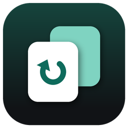

# Sparecopy

Self-hosted backup for your own computers and your family's — to a NAS, a server, or a USB drive — with one web dashboard to watch and manage all of it from any device. A Bytehawk Studio app.

> **Status: early preview (v0.1.0), Windows only.** This release is the app's shell: the Overview shows the planned
> layout, and every other section is a "coming soon" page listing what it will do. **Nothing is backed up yet.**
> Light and dark mode work (header toggle, or Settings → Appearance → "Match Windows").

## What's in the app

| Section | Status |
| --- | --- |
| **Overview** | Layout in place: devices by location, destinations, activity, how it will work |
| **Devices** | Coming soon |
| **Backup Plans** | Coming soon |
| **Destinations** | Coming soon |
| **Schedules** | Coming soon |
| **Browse & Restore** | Coming soon |
| **Activity** | Coming soon |
| **Mobile** | Coming soon |
| **Sparecopy Server** | Coming soon |
| **Settings** | Appearance works; this PC, server connection and alerts are coming soon |

## Download

Windows 10/11 (x64). Get it from the [latest release](../../releases/latest):

- **`Sparecopy-<version>-Setup.exe`**: installer with Start Menu shortcut, optional desktop shortcut and an
  uninstaller. Installs just for you by default (no administrator prompt).
- **`Sparecopy-<version>-win-x64.zip`**: portable. Unzip anywhere and run `Sparecopy.exe`.

Or install it from the **[Bytehawk Studio Launcher](https://github.com/adamglassner/bytehawklauncher)**, which
downloads the newest release, installs it and keeps it up to date. Neither needs .NET installed.

## Building and releasing

- Run from source: `run.bat` (needs the .NET 8 SDK).
- Build the exe, zip and installer: `.\build.ps1` (needs the .NET 8 SDK and Inno Setup 6).
- **Release:** change `<Version>` in `src/Sparecopy.Desktop/Sparecopy.Desktop.csproj` and push to `main`.
  GitHub Actions ([build-release.yml](.github/workflows/build-release.yml)) builds on Windows, runs the self-test
  (every page in both themes), installs and uninstalls the setup silently the way the launcher does, takes
  screenshots, and publishes GitHub Release `v<version>` with the Setup .exe and the portable zip.
- Icon and installer images: `python tools/make_icon.py` then `python tools/make_wizard_images.py`.

## Goals

- **Per-device destinations** — each PC (or phone) chooses where its backups go: NAS share, server folder, or a USB drive plugged into that machine.
- **Multiple backups per device** — e.g. Mom & Dad's PC backs up to a USB drive *and* to the family NAS, as two separate plans.
- **One dashboard for everything** — a Sparecopy server (Docker) hosts a web UI you can open from any device to see every machine, every plan, and every destination at a glance.
- **Works across networks** — monitor and manage devices at different houses (your place and your parents' place) from the same dashboard. Each device runs a small agent that dials *out* to the server through a secure relay, so no port forwarding is needed.
- **Choose what gets backed up** — pick folders, plus skip rules (`*.tmp`, Recycle Bin, very large files…).
- **Mobile backups** — phone app backs up photos & videos and lets you check on the family's backups.
- **Schedules** — every few hours, daily, weekly, when a drive is plugged in, or manual; catch up on missed runs.
- **Browse & restore** — pick any backup version, see exactly which files it contains (new / changed / deleted), and restore to the original PC, another folder, or a zip download.
- **Versions & encryption** — keep N daily / weekly / monthly versions; optional password encryption.

## Planned architecture (draft)

| Piece | What it does |
| --- | --- |
| **Server** (Docker) | Web dashboard + API, stores device/plan config and run history, relays commands to agents |
| **Agent** (Windows / macOS / Linux) | Runs on each computer, does the actual backups on schedule, reports status to the server |
| **Mobile app** (Android / iOS) | Backs up the phone's photos & videos; mobile view of the dashboard |
| **Relay** | Lets agents in other houses reach the server without opening router ports |

Note: iOS limits background work, so iPhone backups will mostly run while the app is open or the phone is charging on Wi-Fi.

## Mockup

The UI mockup lives in [`design/mockup/`](design/mockup):

| File | Screen |
| --- | --- |
| `Main.dc.html` | Overview — all devices grouped by location, plan status, destinations, activity |
| `Device.dc.html` | One device with two backup plans (USB + NAS) and recent runs |
| `Plan.dc.html` | Backup plan editor — destination, folders, schedule, versions, encryption |
| `Restore.dc.html` | Browse backup versions and restore files |
| `Phone.dc.html` | Mobile app home screen |

These are design-canvas source files from a Claude Design artifact (they need that canvas's runtime to render). Device names, sizes and dates are placeholder data.
